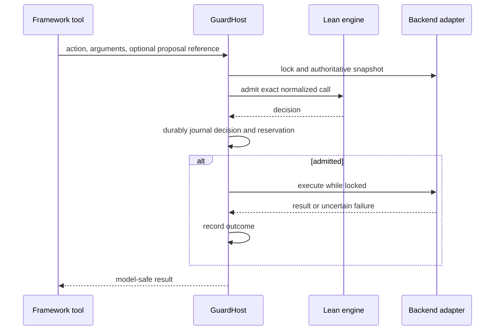

# Agent framework integrations

This is the implementation contract and researched inventory for [roadmap #31](https://github.com/DebarghaG/LeanGuard/issues/31).
The inventory records proposed integration points, not certification or current support.
References were checked on 2026-11-15 against `main` at `d0027a1`.

## Execution contract

Every supported tool implementation delegates its actual operation to
`GuardHost.execute`. The host takes its lock and the backend adapter's lock,
obtains an authoritative snapshot, admits the call with the compiled Lean pack,
journals the decision and dispatch reservation, executes the backend, and records
the outcome. Keep this complete operation together. A pre-tool callback that
checks a policy and subsequently releases control to an unrelated executor does
not preserve the snapshot, approval binding, or durable reservation.

Native tools and MCP tools are two entry points into that same host. A service
for another language must own backend execution too; an allow response sent to
a remote caller for later execution is insufficient. Reuse MCP before adding
another transport. Do not reproduce Lean evaluation in Python, JavaScript, Java,
or C#.

The application supplies principal, session, policy executable, backend, clock,
and delegated authority. Model arguments cannot select another principal or
replace authoritative facts. Framework call IDs are correlation data, not
globally unique journal IDs. The current `request_id` parameter does not promise
idempotent result replay.

An asynchronous adapter must execute the complete host operation on one worker
thread, respecting its synchronous lock ownership. Cancelling the awaiting task
does not prove the worker stopped. Host shutdown must wait for in-flight work;
never automatically retry a timeout or lost response. Initially support
synchronous backend adapters, even in asynchronous framework APIs; async-only
backends require a separately designed host contract.

## Results, approval, and coverage

| Result | Framework behavior |
| --- | --- |
| Denied | Return a denial; zero backend dispatches |
| Allowed, success | Return the recorded backend result |
| Allowed, read-only failure | Return failure; only an adapter can establish absence of effects |
| Allowed, unknown | Preserve uncertainty; require reconciliation, never automatic retry |
| Exception after dispatch | Propagate without claiming nothing happened; the journal may retain an unresolved dispatch |

Expose the minimum necessary diagnostics to the model. Rule internals, facts,
approval payloads, and backend errors belong in authorized operator views. Keep
structured status and request correlation so callers cannot mistake unknown for
success. Tool schemas describe inputs, not authority or policy guarantees.

Human approval uses `prepare`, exact `Proposal.details`, trusted `confirm`, then
`execute` with the proposal reference. The agent may carry that reference but
cannot create a confirmation. A framework's pause/resume or approval bit is not
automatically a LeanGuard confirmation. Revalidate arguments, backend revision,
session, and delegated scope on resume. Approval never overrides native denial.

All writers to the backend must observe the adapter's lock or an equivalent
transaction/revision contract. Remove raw copies of guarded tools and credentials
from the agent. Code execution, shell, browser, provider-hosted tools, nested
agents, and arbitrary workflow nodes need separate coverage. A parent tool's
admission does not certify every effect its implementation can perform.

Use `MultiAgentHost` for shared delegation budgets; do not allocate an unrelated
`GuardHost` to every child and claim shared authority. The existing A2A SDK
coexistence decision remains [#23](https://github.com/DebarghaG/LeanGuard/issues/23).

Lean proves the evaluator's relationship to its formal semantics. Python host
behavior and SDK interception are tested runtime properties. Backend fidelity,
complete mediation, credential isolation, and trustworthy approval remain
deployment assumptions. See [the guarantee boundary](guarantees.md).

## Support and upgrades

An integration becomes **tested** only when its actual SDK invocation path passes
native-engine tests with recorded versions. A **recipe** documents a deployment
but must list untested execution paths. **Experimental** means the path exists
but its support contract is incomplete. **Unsupported** capabilities are named
explicitly. None of these labels means the framework itself is formally proved.

Keep SDK dependencies optional and isolated from core imports. Use public APIs,
pin exact versions in conformance environments, and record the supported range.
Test minimum and newest-compatible versions before widening that range. Upgrade
PRs include release-note review and the conformance results. Avoid runtime
version guessing, private monkey patches, and broad dependency upgrades.

Conformance must exercise denial with a backend spy, admitted calls, malformed
inputs, revoked/consumed/stale approvals, unknown outcomes, journal recovery,
concurrent calls and session isolation. Add each SDK's applicable sync/async,
streaming, cancellation, retries, dynamic tools, nested agents, and resume paths.
Use deterministic model responses; no paid model call is necessary. Required
integration jobs must install their dependencies and fail if tests are skipped.

## Delivery dependencies

1. [Shared contract #33](https://github.com/DebarghaG/LeanGuard/issues/33), then
   Strands and LangChain establish concrete reusable code and fixtures.
2. [Conformance and upgrades #35](https://github.com/DebarghaG/LeanGuard/issues/35)
   grow with the adapters; don't design an unused plugin hierarchy first.
3. [Execution service #34](https://github.com/DebarghaG/LeanGuard/issues/34)
   enables non-Python and remote clients without moving dispatch outside the host.
4. Each issue below receives an implementation or deployment PR and an explicit
   coverage record. The waves indicate dependency order, not exclusion from scope.

## Framework inventory

| Framework | Wave | Proposed execution boundary | Required special coverage | Issue |
| --- | --- | --- | --- | --- |
| [Strands Agents](https://strandsagents.com/docs/user-guide/sdk/tools/executors/) | 1 | Register guarded tool implementations; use BeforeToolCallEvent only for UX or routing. The callable must delegate execution to GuardHost. | Exercise concurrent executors and per-tool cancellation; later hooks must not rewrite an already admitted call. | [#36](https://github.com/DebarghaG/LeanGuard/issues/36) |
| [LangChain and LangGraph](https://docs.langchain.com/oss/python/langchain/middleware/custom) | 1 | Expose guarded BaseTool/StructuredTool implementations for create_agent and ToolNode; evaluate wrap_tool_call middleware only when it can preserve the complete host transaction. | Cover sync/async invocation, parallel ToolNode calls, argument-injecting middleware, checkpoint resume, and retries. Preserve tool-call IDs without treating framework IDs as globally unique journal IDs. | [#37](https://github.com/DebarghaG/LeanGuard/issues/37) |
| [LangChain Deep Agents](https://docs.langchain.com/oss/python/langchain/middleware/built-in) | 2 | Reuse the LangChain integration and explicitly inventory built-in filesystem, shell, and subagent tools. | Inherited middleware is not evidence of full coverage. Shell/code access and subagents can bypass application tools; restrict credentials and capabilities or mark them outside the guarantee. | [#38](https://github.com/DebarghaG/LeanGuard/issues/38) |
| [OpenAI Agents SDK](https://openai.github.io/openai-agents-python/guardrails/) | 1 | Supply FunctionTool implementations whose invocation delegates to GuardHost; native tool guardrails may add checks but do not replace host-owned dispatch. | Hosted and built-in execution tools do not all use the function-tool guardrail pipeline. Enumerate unsupported tools, handoffs, nested agents, approvals, and parallel function calls. | [#39](https://github.com/DebarghaG/LeanGuard/issues/39) |
| [Claude Agent SDK](https://code.claude.com/docs/en/agent-sdk/permissions) | 2 | Expose LeanGuard-owned tools through MCP and constrain allowed tools. Treat permission callbacks as SDK controls, not as a replacement for the durable execution host. | Permission modes and allow rules can change callback reachability. Test configured routes and exclude uncontrolled shell, filesystem, and hosted operations. | [#40](https://github.com/DebarghaG/LeanGuard/issues/40) |
| [Google ADK](https://adk.dev/callbacks/types-of-callbacks/) | 1 | Implement guarded function/BaseTool execution; connect before_tool_callback or plugin callbacks to denial and approval UX without splitting admission from execution. | Test callback ordering, parallel tools, session restore, and subagents. ToolContext or model-supplied state cannot supply trusted principal, approval, or backend facts. | [#41](https://github.com/DebarghaG/LeanGuard/issues/41) |
| [Microsoft Agent Framework](https://learn.microsoft.com/en-us/agent-framework/concepts/agents/middleware/) | 2 | Use function-calling middleware or guarded functions, with a separate execution-service client for .NET. | Test streaming and non-streaming paths and middleware continuation ordering. Python and .NET have distinct support matrices; do not port the evaluator into either client. | [#42](https://github.com/DebarghaG/LeanGuard/issues/42) |
| [Semantic Kernel](https://learn.microsoft.com/en-us/semantic-kernel/concepts/enterprise-readiness/filters) | 3 | Provide guarded KernelFunction implementations or an invocation filter backed by the execution service. | Distinguish function invocation from prompt filters; cover direct and automatic invocation. Keep this compatibility track independent of Microsoft Agent Framework. | [#43](https://github.com/DebarghaG/LeanGuard/issues/43) |
| [AutoGen](https://microsoft.github.io/autogen/stable/user-guide/core-user-guide/components/tools.html) | 3 | Provide guarded FunctionTool/BaseTool or MCP Workbench tools at the actual invocation boundary. | Cover run_json, cancellation, team handoffs, and direct invocation. A message intervention handler alone does not cover local tools; unrestricted code executors remain outside coverage. | [#44](https://github.com/DebarghaG/LeanGuard/issues/44) |
| [CrewAI](https://docs.crewai.com/en/learn/tool-hooks) | 2 | Supply guarded custom tools; integrate tool hooks for diagnostics and human review. | Test cache behavior, retries, crews/flows, concurrent execution, and hook registration scope. A cached answer must not manufacture a fresh authoritative observation. | [#45](https://github.com/DebarghaG/LeanGuard/issues/45) |
| [LlamaIndex](https://developers.llamaindex.ai/python/framework/module_guides/deploying/agents/tools/) | 2 | Expose FunctionTool/AsyncBaseTool-compatible guarded tools for agent workflows. | Cover both call/acall, workflow resume, tool errors, and nested query engines. Retrieval components that perform side effects need their own guarded backend. | [#46](https://github.com/DebarghaG/LeanGuard/issues/46) |
| [PydanticAI](https://pydantic.dev/docs/ai/tools-toolsets/toolsets/) | 2 | Use a guarded toolset or WrapperToolset.call_tool delegating to a host-owned backend. | Test deferred tools, approval resume, parallel calls, and ModelRetry. RunContext dependencies must be bound by trusted application code. | [#47](https://github.com/DebarghaG/LeanGuard/issues/47) |
| [Agno](https://docs.agno.com/tools/overview) | 2 | Expose guarded callable tools/toolkits and use tool hooks only where execution ownership is preserved. | Test tool-result caching, dynamic tool registration, teams, retries, and confirmation pauses; invalidate stale approvals on resume. | [#48](https://github.com/DebarghaG/LeanGuard/issues/48) |
| [Haystack](https://haystack.deepset.ai/release-notes/3.0.0) | 2 | Target Agent-owned tool execution in Haystack 3; guarded Tool callables should provide the enforcement boundary. | Haystack 3 removed standalone ToolInvoker. Do not build a new adapter around the old API; any 2.x support requires a distinct tested compatibility path. | [#49](https://github.com/DebarghaG/LeanGuard/issues/49) |
| [Hugging Face smolagents](https://huggingface.co/docs/smolagents/reference/tools) | 3 | Supply guarded Tool implementations; begin with ToolCallingAgent. | CodeAgent can perform operations outside registered tools. Constrain the executor and credentials before making broader claims; test generated-code bypass attempts and serialization. | [#50](https://github.com/DebarghaG/LeanGuard/issues/50) |
| [DSPy](https://github.com/stanfordnlp/dspy/blob/main/dspy/predict/react.py) | 3 | Wrap tool callables used by ReAct with host-owned execution. | Keep optimizers and prompt compilation outside policy authority; test sync/async tool calls and ensure optimization never substitutes a raw backend callable. | [#51](https://github.com/DebarghaG/LeanGuard/issues/51) |
| [CAMEL](https://docs.camel-ai.org/key_modules/tools) | 3 | Expose guarded FunctionTool callables and explicit per-agent bindings. | Test toolkit composition and multi-agent workers; code execution, browser access, and raw network tools cannot inherit coverage just because another toolkit is guarded. | [#52](https://github.com/DebarghaG/LeanGuard/issues/52) |
| [Letta](https://github.com/letta-ai/letta-docs-md/blob/main/agent-sdk/mcp/index.md) | 3 | Use SDK client tools or MCP tools to send execution to LeanGuard; specify which SDK generation is supported. | Separate client-side tools from server-side built-ins and memory tools. Test resumed sessions and remove duplicate unguarded tool registrations. | [#53](https://github.com/DebarghaG/LeanGuard/issues/53) |
| [Vercel AI SDK](https://ai-sdk.dev/docs/ai-sdk-core/tools-and-tool-calling) | 2 | Implement server-side tool.execute wrappers using the shared execution-service client, or use guarded MCP tools. | Cover generateText/streamText, aborts, parallel calls, and approval resumption. Browser/client tools and provider-executed tools need explicit coverage exclusions. | [#54](https://github.com/DebarghaG/LeanGuard/issues/54) |
| [Mastra](https://mastra.ai/docs/agents/tools) | 2 | Implement createTool execute callbacks using the shared TypeScript execution client, plus a guarded MCP recipe. | Test workflows, suspension/resume, cancellation, and request context binding. Do not serialize functions or treat request context supplied by a model as authority. | [#55](https://github.com/DebarghaG/LeanGuard/issues/55) |
| [Spring AI](https://docs.spring.io/spring-ai/reference/api/tools.html) | 3 | Provide ToolCallback implementations that invoke LeanGuard-owned execution through a shared service client. | Cover advisor-driven calls and low-level ChatModel routes; declare the supported major version and test streaming, retries, and lossless number encoding. | [#56](https://github.com/DebarghaG/LeanGuard/issues/56) |
| [LangChain4j](https://docs.langchain4j.dev/tutorials/tools/) | 3 | Provide ToolExecutor implementations calling the execution service with trusted session bindings. | Test dynamic ToolProvider registration, parallel invocations, immediate returns, and numeric fidelity; reuse the JVM client rather than reimplementing policy evaluation. | [#57](https://github.com/DebarghaG/LeanGuard/issues/57) |
| [Amazon Bedrock Agents](https://docs.aws.amazon.com/bedrock/latest/userguide/agents-returncontrol.html) | 2 | Route RETURN_CONTROL action groups, or trusted Lambda action handlers, through LeanGuard-owned execution. | Bind invocationId to trusted account/session context, test duplicate delivery and uncertain outcomes, and enumerate managed actions that never return control. | [#58](https://github.com/DebarghaG/LeanGuard/issues/58) |
| [n8n](https://docs.n8n.io/integrations/builtin/cluster-nodes/sub-nodes/n8n-nodes-langchain.toolmcp) | 3 | Ship an importable workflow using the MCP Client Tool connected only to LeanGuard's guarded tools. | Requires a supported authenticated remote MCP deployment. Other workflow nodes and direct credentials can bypass the gate; test retries and workflow resumes. | [#59](https://github.com/DebarghaG/LeanGuard/issues/59) |
| [Dify](https://docs.dify.ai/en/develop-plugin/dev-guides-and-walkthroughs/tool-plugin) | 3 | Build a tool-provider plugin delegating to the execution service, or a verified guarded MCP configuration where supported. | Keep provider credentials server-side; cover plugin retries, streaming responses, workflow branches, and action-name validation. | [#60](https://github.com/DebarghaG/LeanGuard/issues/60) |
| [Langflow](https://docs.langflow.org/mcp-client) | 3 | Ship an MCP Tools component recipe connected to LeanGuard, with a repeatable exported flow. | Verify the exported flow contains no duplicate raw tools, binds sessions outside model input, and preserves deny/unknown results across retries. | [#61](https://github.com/DebarghaG/LeanGuard/issues/61) |
| [Flowise](https://docs.flowiseai.com/tutorials/tools-and-mcp) | 3 | Ship a Custom MCP configuration and exported agent flow targeting LeanGuard. | Test the selected transport and node version, avoid unguarded alternate tools, and preserve denial and uncertain outcomes through workflow error handling. | [#62](https://github.com/DebarghaG/LeanGuard/issues/62) |
